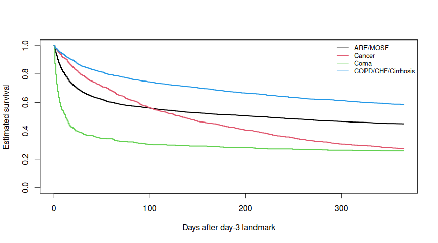

# Clinical Survival Analysis with R and Python

**Survival prediction, model diagnostics, and missing-data sensitivity using SUPPORT2 clinical data.**

I built this project to answer two connected questions: **how well can clinical characteristics predict survival, and how defensible are the associations estimated by the models?** Python provides the prediction and validation workflow; R adds clinical interpretation, assumption checks, and sensitivity analysis.

**Explore:** [Python notebook](SUPPORT2.ipynb) · [Executed R report](reports/SUPPORT2_R_report.md) · [Editable R source](SUPPORT2_R_portfolio.qmd)

## Dataset and study population

[SUPPORT2](https://archive.ics.uci.edu/dataset/880/support2) contains records from **9,105 seriously ill hospitalized adults across five US medical centers**, collected during 1989–1994. The outcome is time to observed death, with right-censoring for patients whose death was not observed during follow-up.

I use a **day-3 landmark**: patients must remain under observation beyond study day 3, and follow-up begins from that landmark. This leaves **8,967 patients**, split into **7,173 training** and **1,794 test** patients using an event-stratified 80/20 split (`random_state=42`). The R analysis uses the training cohort only.

Data provenance and variable definitions: [UCI repository](https://archive.ics.uci.edu/dataset/880/support2) · [Original SUPPORT documentation](https://hbiostat.org/data/repo/supportdesc).

## Analysis

| Python: prediction and validation | R: associations and sensitivity |
|:--|:--|
| Preprocessing fitted within training data and CV folds | Clinical summaries and measurement plausibility checks |
| Penalized Cox regression and Random Survival Forest | Adjusted Cox HRs and confidence intervals |
| Five-fold cross-validation and held-out evaluation | Schoenfeld residual tests and diagnosis stratification |
| C-index, 180/365-day Brier scores, and calibration | Natural cubic spline comparison for age |
| Paired bootstrap intervals and subgroup evaluation | Survival-informed multiple imputation and pooled estimates |

Both notebooks explain the choices and limits of the analysis. The Python notebook also includes PH diagnostics through a separate `lifelines` refit. The R companion extends the inferential investigation; the project does not claim an accuracy advantage of one language over the other.

## Key results

**Python held-out results, as saved in the notebook:**

| Model | C-index, original 30 predictors | C-index, reduced 28 predictors |
|:--|--:|--:|
| Penalized Cox | 0.6907 | 0.6802 |
| Random Survival Forest | 0.6827 | 0.6736 |

On this held-out split, Cox has slightly higher discrimination: the paired bootstrap C-index difference is **0.0080** (95% CI **0.0005–0.0157**). This small advantage does not establish superiority across other cohorts. Removing `scoma` and `adlsc` reduced discrimination for both models in this comparison; that result is retained rather than presented as an improvement.

**R findings from the reduced-feature training export:**

- The clinical Cox model uses **7,128 complete cases**. Its global PH test indicates substantial departures (χ² = 730.46, p < 0.001).
- Allowing separate baseline hazards by diagnosis leaves PH departures (global χ² = 78.95, p < 0.001).
- A three-degree-of-freedom age spline gives little evidence of improved fit over linear age (likelihood-ratio p = 0.206).
- Albumin is missing in **36.78%** of training patients. Including albumin leaves **4,535 complete cases**, compared with **7,173 patients per imputed dataset**. The albumin HR is 0.913 in complete cases and 0.915 after imputation (MI 95% CI 0.870–0.963).

**What I take from this:** predictive evaluation and statistical interpretation answer different questions. A fitted model can provide useful exploratory results while its assumptions still require attention. Here, extra age flexibility was not clearly supported, diagnosis stratification did not solve all PH concerns, and missing-data handling changed the available sample and some estimates.



## Reproduce the work

The original dataset and executed Python notebook are included. The R report is also available as Markdown with figures, so it can be read directly on GitHub.

1. Install Python 3.11+ and the packages in `requirements.txt`:

   ```bash
   python -m pip install -r requirements.txt
   jupyter lab SUPPORT2.ipynb
   ```

   The notebook fetches SUPPORT2 through `ucimlrepo`, which requires internet access. Its saved outputs can be inspected without rerunning it.

2. Recreate the R input from the included `support2.csv`, using the notebook's landmark, exclusions, and split:

   ```bash
   python scripts/export_r_training.py
   ```

   This generates `support2_trained.csv`, a patient split manifest, and export provenance. It does not fit a predictive model or use the held-out outcomes to develop the R analysis.

3. Install R and [Quarto](https://quarto.org/docs/get-started/), then install the R packages in the environment used by Quarto:

   ```r
   install.packages(c("survival", "ggplot2", "knitr", "rmarkdown", "mice"))
   ```

4. Render the R report:

   ```bash
   quarto render SUPPORT2_R_portfolio.qmd
   ```

   This produces a standalone HTML report. `mice` is required for the complete analysis; without it, the report explicitly skips imputation. R package versions are recorded in the executed report. Python dependencies are listed without a frozen environment, so exact results can vary across package versions.

## Scope and next steps

This is an **exploratory analysis of historical observational data**. HRs describe associations, not causal effects. PH departures and flagged measurements remain unresolved, and the imputation model uses a PH-based approximation. Further work would examine time-dependent coefficients, compatible imputation models, measurement sensitivity, and external validation before stronger clinical conclusions.

The project demonstrates practical skills in **survival modeling, reproducible preprocessing, predictive evaluation, assumption diagnostics, missing-data analysis, and scientific communication**. Its main contribution is the documented analysis and reasoning on a shared clinical cohort.
