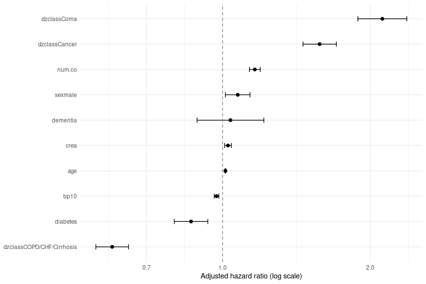
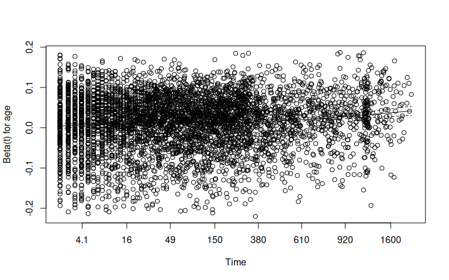
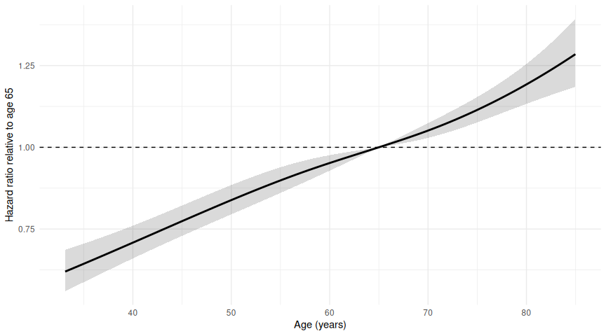
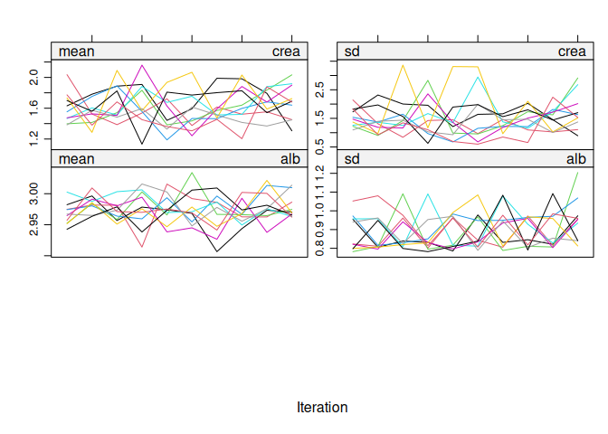

[Project overview](../README.md) · [Editable Quarto source](../SUPPORT2_R_portfolio.qmd)

# Clinical Survival Analysis in R (SUPPORT2)


## Research question and scope

In my Python SUPPORT2 notebook, I examined survival prediction using Cox
regression and Random Survival Forest. Here, I use R to ask a related
question: **how are selected clinical characteristics associated with
mortality, and how much confidence can I place in those estimates?** I
focus on adjusted hazard ratios, model assumptions, nonlinear age
effects, and sensitivity to missing data.

I reuse the **day-3 landmark training cohort** and the export containing
28 predictors after excluding `scoma` and `adlsc`. The event is observed
death (`event = 1`), and `time` measures follow-up in days **after** the
landmark. I keep the Python test set separate so that this exploratory
work does not reuse the patients reserved for predictive evaluation. The
R models use a smaller clinical subset of the exported predictors; this
report compares the contributions of the two workflows rather than
benchmarking the languages.

## Project contribution

The project combines **predictive modeling in Python** with
**statistical interpretation in R** using SUPPORT2, a historical dataset
of 9,105 seriously ill hospitalized patients. Python provides the
prediction and validation workflow. R gives me a convenient way to
investigate clinical associations, check assumptions, and examine
uncertainty from missing measurements.

I follow the sequence **data quality → clinical summaries → model
estimation → diagnostics → sensitivity analysis → interpretation**. Each
step answers a question raised by the previous one. My aim is to show
both what the fitted models suggest and where their conclusions need
more work.

## Setup and study population

**Why I start here.** Before fitting any model, I check the cohort,
outcome coding, and follow-up definition. The landmark includes patients
observed beyond study day 3, and subtracting three days puts their
follow-up on the same time scale. Reusing the existing split keeps the R
and Python components aligned. It also means that these results describe
the landmark training cohort rather than all SUPPORT2 patients.

The file `support2_trained.csv` must be beside this `.qmd` document. It
can be exported from the Python notebook using:

``` python
# Run this once in SUPPORT2.ipynb, not in the R report.

pd.concat([X_train_reduced, y_train], axis=1).to_csv(
    "support2_trained.csv", index=False
)
```

``` r
required <- c("survival", "ggplot2", "knitr")
missing_packages <- required[!vapply(required, requireNamespace, logical(1), quietly = TRUE)]
if (length(missing_packages)) {
  stop("Missing R packages: ", paste(missing_packages, collapse = ", "),
       ". Install them into the R environment used by Quarto.")
}

library(survival)
library(ggplot2)
library(knitr)
library(splines)  # Provides natural cubic splines

format_p <- function(p) format.pval(p, digits = 3, eps = 0.001)
ph_table <- function(object) {
  tab <- data.frame(Term = rownames(object$table), object$table, row.names = NULL)
  tab$p <- format_p(tab$p)
  tab
}

input <- "support2_trained.csv"
if (!file.exists(input)) {
  stop("Cannot find '", input, "' beside this Quarto document. Export it from Python first.")
}
train <- read.csv(input, stringsAsFactors = FALSE)

needed <- c("time", "event", "age", "sex", "dzclass", "num.co",
            "diabetes", "dementia", "meanbp", "crea", "alb")
stopifnot(all(needed %in% names(train)))
stopifnot(!anyNA(train[c("time", "event")]))
stopifnot(all(is.finite(train$time)), all(train$time > 0),
          all(train$event %in% c(0, 1)))

n_imported_predictors <- length(setdiff(names(train), c("time", "event")))
train$sex <- factor(train$sex)
train$dzclass <- factor(train$dzclass)
train$bp10 <- train$meanbp / 10  # HR per 10-unit increase in mean BP

cat("Training patients:", nrow(train), "\n")
```

    Training patients: 7173 

``` r
cat("Observed deaths:", sum(train$event == 1), "\n")
```

    Observed deaths: 4850 

``` r
cat("Right-censored:", sum(train$event == 0), "\n")
```

    Right-censored: 2323 

``` r
cat("Predictor columns in exported CSV:", n_imported_predictors, "\n")
```

    Predictor columns in exported CSV: 28 

**Interpretation.** The training cohort contains **7,173 patients**,
with **4,850 observed deaths** and **2,323 censored observations**. A
censored observation means that death was not observed during that
patient’s follow-up; it does not establish what happened afterward. The
estimates below apply to patients observed beyond study day 3 in this
training partition.

## Clinical characteristics and data quality

**Why I check the data before modeling.** I need to understand who is
represented in the cohort and which measurements are incomplete.
Otherwise, a model could conceal differences in the patient groups or
rely on a selected subset of patients without making that clear. I first
report missingness using the recorded values, before any imputation.

``` r
clinical_vars <- c("age", "sex", "dzclass", "num.co", "diabetes",
                   "dementia", "meanbp", "crea", "alb")

missing <- data.frame(
  Variable = clinical_vars,
  N_missing = vapply(train[clinical_vars], function(x) sum(is.na(x)), integer(1)),
  Missing_pct = vapply(train[clinical_vars], function(x) mean(is.na(x)) * 100, numeric(1)),
  row.names = NULL
)
knitr::kable(missing, digits = 2, caption = "Missingness in selected clinical variables")
```

| Variable | N_missing | Missing_pct |
|:---------|----------:|------------:|
| age      |         0 |        0.00 |
| sex      |         0 |        0.00 |
| dzclass  |         0 |        0.00 |
| num.co   |         0 |        0.00 |
| diabetes |         0 |        0.00 |
| dementia |         0 |        0.00 |
| meanbp   |         0 |        0.00 |
| crea     |        45 |        0.63 |
| alb      |      2638 |       36.78 |

Missingness in selected clinical variables

I then summarize the patients by diagnosis. Age, comorbidity burden, and
missingness may differ between these groups, which helps explain why an
unadjusted survival comparison and an adjusted model can give different
impressions. I summarize age with its median and interquartile range,
and comorbidity count with its median, so the description is less
influenced by extreme observations.

``` r
by_diagnosis <- lapply(split(train, train$dzclass), function(d) {
  data.frame(
    N = nrow(d),
    Deaths = sum(d$event == 1),
    Age_median = median(d$age, na.rm = TRUE),
    Age_IQR = IQR(d$age, na.rm = TRUE),
    Female_pct = mean(d$sex == "female", na.rm = TRUE) * 100,
    Comorbidities_median = median(d$num.co, na.rm = TRUE),
    Diabetes_pct = mean(d$diabetes == 1, na.rm = TRUE) * 100,
    Albumin_missing_pct = mean(is.na(d$alb)) * 100
  )
})
clinical_table <- do.call(rbind, by_diagnosis)
clinical_table <- data.frame(Diagnosis = rownames(clinical_table),
                             clinical_table, row.names = NULL)
knitr::kable(clinical_table, digits = 1,
             caption = "Training-cohort characteristics by diagnostic category")
```

| Diagnosis | N | Deaths | Age_median | Age_IQR | Female_pct | Comorbidities_median | Diabetes_pct | Albumin_missing_pct |
|:---|---:|---:|---:|---:|---:|---:|---:|---:|
| ARF/MOSF | 3312 | 2112 | 63.4 | 25.4 | 45.2 | 1 | 20.9 | 34.9 |
| Cancer | 1126 | 1004 | 63.6 | 14.8 | 39.7 | 1 | 8.3 | 39.0 |
| Coma | 444 | 346 | 66.1 | 21.8 | 50.5 | 1 | 18.9 | 38.7 |
| COPD/CHF/Cirrhosis | 2291 | 1388 | 66.8 | 19.3 | 40.7 | 3 | 22.8 | 38.0 |

Training-cohort characteristics by diagnostic category

Before fitting the Cox models, I also flag measurements that deserve a
source or unit check. These flags are prompts for review, not
established cleaning rules. I leave the recorded values in place because
I cannot justify replacing or excluding them from the available
information.

``` r
# Flags for review only; not automatic exclusions.
audit <- data.frame(
  Check = c("Mean arterial pressure <= 0", "Albumin > 6 (assuming g/dL)",
            "Albumin <= 0", "Creatinine <= 0"),
  N = c(sum(train$meanbp <= 0, na.rm = TRUE),
        sum(train$alb > 6, na.rm = TRUE),
        sum(train$alb <= 0, na.rm = TRUE),
        sum(train$crea <= 0, na.rm = TRUE))
)
knitr::kable(audit, caption = "Values requiring clinical or unit verification")
```

| Check                        |   N |
|:-----------------------------|----:|
| Mean arterial pressure \<= 0 |  23 |
| Albumin \> 6 (assuming g/dL) |   4 |
| Albumin \<= 0                |   0 |
| Creatinine \<= 0             |   0 |

Values requiring clinical or unit verification

In this exported cohort, the median age is **64.7 years**, ARF/MOSF
accounts for **46.2%** of the patients, and albumin is missing for
**36.8%**.

**Interpretation.** The amount of missing albumin makes a missing-data
sensitivity analysis worthwhile. The high albumin values and zero mean
blood pressure readings also need verification. I cannot determine their
cause from this export, and they remain a limitation of the fitted
models. The albumin cutoff assumes g/dL and is an illustrative review
flag, not a validated SUPPORT2 exclusion rule.

## Unadjusted survival by diagnosis

**Why I begin with Kaplan–Meier curves.** Before adjusting for other
characteristics, I want to see how survival differs across diagnostic
groups and when those differences appear. Kaplan–Meier estimation
accounts for right-censoring without imposing the Cox model’s covariate
structure. I display the first year to keep the comparison readable.
Interpretation assumes that censoring is non-informative within each
group.

``` r
km_group <- survfit(Surv(time, event) ~ dzclass, data = train)
plot(km_group, col = seq_along(levels(train$dzclass)), lwd = 2,
     xlim = c(0, 365), ylim = c(0, 1),
     xlab = "Days after day-3 landmark", ylab = "Estimated survival")
legend("topright", legend = levels(train$dzclass),
       col = seq_along(levels(train$dzclass)), lty = 1,
       bty = "n", cex = 0.8)
```

<div id="fig-survival-diagnosis">


Figure 1: Kaplan–Meier estimates by diagnostic category, first year
after study day 3

</div>

I use the log-rank test to assess whether the groups have the same
survival distribution across the available follow-up. This is an overall
comparison: it does not tell me that every pair of groups differs. I
read it alongside the curves because crossing curves and changing
differences over time can make a single test result an incomplete
summary.

``` r
logrank <- survdiff(Surv(time, event) ~ dzclass, data = train)
logrank_p <- pchisq(logrank$chisq, df = length(logrank$n) - 1,
                    lower.tail = FALSE)
knitr::kable(data.frame(Test = "Log-rank", Chi_square = logrank$chisq,
                        df = length(logrank$n) - 1, p_value = format_p(logrank_p)),
             digits = 4)
```

| Test     | Chi_square |  df | p_value |
|:---------|-----------:|----:|:--------|
| Log-rank |   450.4927 |   3 | \<0.001 |

**Interpretation.** COPD/CHF/Cirrhosis has the highest estimated
survival during the first year, while Coma shows the steepest early
decline. Cancer survival falls below ARF/MOSF around day 100. The
log-rank test indicates an overall difference between groups (χ² =
**450.49**, df = **3**, p **\<0.001**). These differences are unadjusted
and do not establish causal effects of diagnosis.

## Adjusted Cox regression: clinical associations

**Why I fit an adjusted model.** The diagnosis groups differ in more
than their diagnosis. I use Cox regression to estimate associations
while accounting for selected demographic and clinical characteristics
at the same time. I include age, sex, diagnosis, comorbidity count,
diabetes, dementia, mean blood pressure, and creatinine to cover several
clinically relevant dimensions while keeping the model readable. This is
an exploratory selection, not a claim that I have included every
important confounder.

These variables have relatively little missingness, so a complete-case
model gives me a starting point with limited sample loss. That practical
choice does not establish that excluding incomplete observations is
unbiased. I assess the much more incomplete albumin variable separately
in the imputation section. I scale blood pressure by ten so its HR
describes a more readable change than a single recorded unit.

This model differs from Python’s penalized 28-feature Cox model. Its
purpose is to examine adjusted associations, so I do not compare their
coefficients or scores as though they were the same specification. An HR
above 1 indicates a higher instantaneous death hazard conditional on the
included covariates; an HR below 1 indicates a lower hazard. An HR is
not a ratio of survival probabilities.

``` r
cox_formula <- Surv(time, event) ~
  age + sex + dzclass + num.co + diabetes + dementia + bp10 + crea

train_cc <- train[complete.cases(train[all.vars(cox_formula)]), ]
cat("Complete-case patients:", nrow(train_cc), "of", nrow(train), "\n")
```

    Complete-case patients: 7128 of 7173 

``` r
cox <- coxph(cox_formula, data = train_cc, ties = "efron", x = TRUE, model = TRUE)
cox_summary <- summary(cox)

hr <- data.frame(
  Term = rownames(cox_summary$coefficients),
  HR = cox_summary$conf.int[, "exp(coef)"],
  Lower_95 = cox_summary$conf.int[, "lower .95"],
  Upper_95 = cox_summary$conf.int[, "upper .95"],
  p_value = format_p(cox_summary$coefficients[, "Pr(>|z|)"]),
  row.names = NULL
)
knitr::kable(hr, digits = 3,
             caption = "Adjusted hazard ratios from the complete-case Cox model")
```

| Term                      |    HR | Lower_95 | Upper_95 | p_value  |
|:--------------------------|------:|---------:|---------:|:---------|
| age                       | 1.013 |    1.011 |    1.015 | \< 0.001 |
| sexmale                   | 1.074 |    1.014 |    1.137 | 0.01559  |
| dzclassCancer             | 1.577 |    1.458 |    1.706 | \< 0.001 |
| dzclassComa               | 2.117 |    1.887 |    2.374 | \< 0.001 |
| dzclassCOPD/CHF/Cirrhosis | 0.596 |    0.552 |    0.643 | \< 0.001 |
| num.co                    | 1.163 |    1.134 |    1.193 | \< 0.001 |
| diabetes                  | 0.862 |    0.797 |    0.933 | \< 0.001 |
| dementia                  | 1.038 |    0.887 |    1.214 | 0.64410  |
| bp10                      | 0.972 |    0.962 |    0.983 | \< 0.001 |
| crea                      | 1.026 |    1.009 |    1.042 | 0.00186  |

Adjusted hazard ratios from the complete-case Cox model

I display the HRs with their confidence intervals so that both the
estimated association and its uncertainty are visible. The logarithmic
axis treats ratios above and below 1 consistently, and the reference
line marks an HR of 1.

``` r
ggplot(hr, aes(x = HR, y = reorder(Term, HR))) +
  geom_point(size = 2) +
  geom_errorbar(aes(xmin = Lower_95, xmax = Upper_95),
                orientation = "y", width = 0.2) +
  geom_vline(xintercept = 1, linetype = "dashed", colour = "grey50") +
  scale_x_log10() +
  labs(x = "Adjusted hazard ratio (log scale)", y = NULL) +
  theme_minimal()
```

<div id="fig-cox-forest">



Figure 2: Adjusted Cox hazard ratios and 95% confidence intervals

</div>

**Clinical interpretation.** This model uses **7,128 complete cases**.
Sex is compared with female, and diagnosis with ARF/MOSF. Age is
measured per year, comorbidity count per additional condition, and
`bp10` per 10-unit increase in recorded mean blood pressure. Creatinine
is interpreted per recorded unit, pending verification of the source
units.

After adjustment, Coma and Cancer are associated with higher hazards
than ARF/MOSF (HRs **2.12** and **1.58**, respectively), while
COPD/CHF/Cirrhosis has a lower hazard (HR **0.6**). Older age, male sex,
additional comorbidities, and higher creatinine are associated with
higher hazards. Diabetes and higher mean blood pressure are associated
with lower hazards in this specification. Dementia shows no clear
association, as its 95% confidence interval includes 1.

These are adjusted associations rather than causal effects. In
particular, the diabetes estimate does not show that diabetes is
protective. The interpretation depends on the model and the selected
covariates, and a single HR can conceal an association that changes over
follow-up. I therefore check proportional hazards next. The unresolved
measurement flags also remain relevant to these estimates.

## Proportional-hazards assumption

**Why I check proportional hazards.** The fitted Cox model represents
each association with a coefficient that is constant over follow-up.
Before interpreting those HRs as constant effects, I need to check
whether that assumption is reasonable. Scaled Schoenfeld residuals and
the Grambsch–Therneau tests look for evidence that the coefficients
change over time. I consider the global test and the individual terms
together; an isolated small p-value can also arise when several tests
are performed.

``` r
ph <- cox.zph(cox, transform = "rank")
knitr::kable(ph_table(ph),
             digits = 4, caption = "Proportional-hazards diagnostic tests")
```

| Term     |    chisq |  df | p        |
|:---------|---------:|----:|:---------|
| age      |  37.6443 |   1 | \< 0.001 |
| sex      |   6.8767 |   1 | 0.00873  |
| dzclass  | 656.3511 |   3 | \< 0.001 |
| num.co   |  94.2059 |   1 | \< 0.001 |
| diabetes |  11.2015 |   1 | \< 0.001 |
| dementia |   0.3781 |   1 | 0.53862  |
| bp10     |  20.9512 |   1 | \< 0.001 |
| crea     |  13.1533 |   1 | \< 0.001 |
| GLOBAL   | 730.4586 |  10 | \< 0.001 |

Proportional-hazards diagnostic tests

I also plot the age residual diagnostic. A table can flag a departure,
but the estimated coefficient curve helps me see its pattern over
follow-up. Under proportional hazards, the underlying coefficient would
be constant. The plot is a diagnostic estimate, and its p-value does not
measure the clinical size of the departure.

``` r
plot(ph, var = "age")
```

<div id="fig-ph-age">



Figure 3: Scaled Schoenfeld residual diagnostics for age

</div>

**Interpretation.** The global test provides strong evidence against
proportional hazards (χ² = **730.46**, p **\<0.001**). The individual
tests also show evidence of departures for every tested covariate except
dementia, with diagnosis producing the strongest signal. The
non-horizontal age coefficient curve is consistent with the age
association changing over follow-up. These findings limit how
confidently I can summarize the associations with constant HRs.

**R’s contribution here:** `cox.zph()` brings the term-level tests,
global test, and residual plots into the same modeling workflow.
Python’s notebook also includes Schoenfeld tests; here, I use the
diagnostics to motivate an alternative specification.

### Alternative specification: diagnosis-stratified Cox model

**Why I try diagnosis stratification.** Diagnosis has the strongest PH
diagnostic signal, and the survival curves suggest that the differences
between groups change over time. Stratification lets each diagnostic
group have its own baseline hazard while the remaining covariate
coefficients are shared across groups. This is a targeted sensitivity
analysis: it addresses the diagnosis component without assuming that the
other PH departures disappear. The trade-off is that the model no longer
estimates diagnosis HRs.

``` r
cox_strat <- coxph(
  Surv(time, event) ~ age + sex + strata(dzclass) + num.co +
    diabetes + dementia + bp10 + crea,
  data = train_cc, ties = "efron", x = TRUE
)
ph_strat <- cox.zph(cox_strat, transform = "rank")
knitr::kable(ph_table(ph_strat),
             digits = 4,
             caption = "Proportional-hazards diagnostics after diagnosis stratification")
```

| Term     |   chisq |  df | p        |
|:---------|--------:|----:|:---------|
| age      | 23.3794 |   1 | \< 0.001 |
| sex      |  2.1966 |   1 | 0.13831  |
| num.co   | 22.4408 |   1 | \< 0.001 |
| diabetes | 28.4303 |   1 | \< 0.001 |
| dementia |  6.7363 |   1 | 0.00945  |
| bp10     | 16.1426 |   1 | \< 0.001 |
| crea     |  0.2930 |   1 | 0.58832  |
| GLOBAL   | 78.9545 |   7 | \< 0.001 |

Proportional-hazards diagnostics after diagnosis stratification

**Interpretation.** The stratified model’s global test remains
significant (χ² = **78.95**, p **\<0.001**). Age, comorbidity count,
diabetes, dementia, and mean blood pressure still show evidence of
departures, while sex and creatinine show no clear departures in this
specification. Separate diagnosis baselines therefore do not fully
resolve the PH concerns. A model with time-dependent coefficients would
be a reasonable next investigation, but I do not fit that extension in
this report.

## Nonlinear age effect

**Why I check the form of the age association.** In my starting
specification, age enters linearly on the **log-hazard** scale. That is
a choice in this model, not a requirement of Cox regression. I use a
natural cubic spline with three degrees of freedom to check whether a
modest amount of curvature improves the fit. The spline contains the
linear age specification as a special case, and both fits use the same
patients and other covariates, so a likelihood-ratio comparison is
appropriate.

This addresses a different question from the PH diagnostic: curvature
across ages is not the same as a coefficient changing over follow-up. I
compare the age forms within the original Cox specification to keep the
change focused. Its unresolved PH departures still limit the strength of
the inference.

``` r
cox_spline <- update(cox, . ~ . - age + splines::ns(age, df = 3))
model_comparison <- anova(cox, cox_spline, test = "Chisq")
print(model_comparison)
```

    Analysis of Deviance Table
     Cox model: response is  Surv(time, event)
     Model 1: ~ age + sex + dzclass + num.co + diabetes + dementia + bp10 + crea
     Model 2: ~ sex + dzclass + num.co + diabetes + dementia + bp10 + crea + splines::ns(age, df = 3)
      loglik  Chisq Df Pr(>|Chi|)
    1 -39703                     
    2 -39702 3.1577  2     0.2062

I plot the fitted age association relative to age 65, a reference close
to the cohort’s median age. I keep the other covariates fixed and
restrict the curve to the central 90% of observed ages to avoid letting
sparse age extremes dominate the display. The band shows pointwise
model-based uncertainty in the HR relative to that reference.

``` r
# Hold other variables constant and vary age.
reference <- train_cc[1, all.vars(cox_formula)[-c(1, 2)], drop = FALSE]
# all.vars() begins with time, event: remove both to keep predictor columns.
reference$sex <- factor(levels(train_cc$sex)[1], levels = levels(train_cc$sex))
reference$dzclass <- factor(levels(train_cc$dzclass)[1], levels = levels(train_cc$dzclass))
for (v in c("num.co", "diabetes", "dementia", "bp10", "crea")) {
  reference[[v]] <- median(train_cc[[v]], na.rm = TRUE)
}
ages <- seq(quantile(train_cc$age, 0.05), quantile(train_cc$age, 0.95), length.out = 100)
new_patients <- reference[rep(1, length(ages)), , drop = FALSE]
new_patients$age <- as.numeric(ages)
ref_patient <- reference
ref_patient$age <- 65

# Evaluate the fitted spline basis consistently using the model's stored terms.
M <- model.matrix(cox_spline, data = new_patients)
M_ref <- model.matrix(cox_spline, data = ref_patient)
delta <- sweep(M, 2, M_ref[1, ], FUN = "-")
log_hr <- drop(delta %*% coef(cox_spline))
se <- sqrt(rowSums((delta %*% vcov(cox_spline)) * delta))
age_curve <- data.frame(
  age = ages,
  HR = exp(log_hr),
  Lower = exp(log_hr - 1.96 * se),
  Upper = exp(log_hr + 1.96 * se)
)

ggplot(age_curve, aes(age, HR)) +
  geom_ribbon(aes(ymin = Lower, ymax = Upper), alpha = 0.18) +
  geom_line(linewidth = 1) +
  geom_hline(yintercept = 1, linetype = "dashed") +
  labs(x = "Age (years)", y = "Hazard ratio relative to age 65") +
  theme_minimal()
```

<div id="fig-age-spline">



Figure 4: Estimated hazard ratio across age, relative to age 65; other
covariates fixed

</div>

**Interpretation.** The spline curve shows an increasing hazard with age
relative to age 65. However, the likelihood-ratio test provides little
evidence that the spline improves fit over a linear age term (χ² =
**3.16**, df = **2**, p = **0.206**). Retaining linear age is reasonable
for this comparison, although it does not resolve the time-varying age
effect identified by the PH diagnostics.

**R’s contribution here:** formula-based model updates, likelihood-ratio
comparison, and an effect curve with uncertainty make a modeling choice
transparent. The analysis demonstrates a test and its interpretation
even when a more flexible specification is not supported.

The confidence bands describe the fitted association under the model;
they are not prediction intervals for individual patients. Even a
significant spline test would not establish better prediction on new
patients.

## Multiple-imputation sensitivity analysis

**Why I examine missing-data sensitivity.** Albumin is missing for a
substantial share of the cohort. Including it only through complete-case
analysis would exclude many patients and could change which patients the
estimates represent. I therefore compare complete-case and multiply
imputed Cox analyses using **the same predictors, including albumin**.
Holding the model formula fixed makes it easier to examine the
consequences of the missing-data strategy, although the two analyses
necessarily use different amounts of patient information.

I include the observed event indicator and the Nelson–Aalen
cumulative-hazard estimate in the imputation model so that the
replacement covariate values can reflect their relationship with the
survival outcome. Survival time and event status are **never imputed**.
This follows the survival-informed approach of [White and Royston
(2009)](https://pubmed.ncbi.nlm.nih.gov/19452569/). Including observed
outcomes is appropriate for this inferential analysis; a prediction
pipeline for new patients cannot use outcomes that are not yet known.

The analysis assumes that missingness can be explained by the variables
in the imputation model—often called **missing at random**—and that the
imputation models are adequate. I cannot establish those assumptions
from the observed data alone. There is a further limitation here: the
imputation strategy uses a PH-based approximation, while the earlier
diagnostics show unresolved PH departures. I treat the pooled HRs as
exploratory. Stronger inference, particularly from a model with
time-dependent coefficients, would require an imputation approach that
accommodates those effects. [Keogh and Morris
(2018)](https://pubmed.ncbi.nlm.nih.gov/30014575/)

I use ten imputations and ten iterations as a manageable exploratory
run, then inspect the sample sizes, pooled intervals, logged events, and
chain plots. This is a starting diagnostic check, not proof that the
imputation has converged or that the estimates are robust. Longer runs,
more imputations, and comparisons of observed and imputed distributions
would be needed for a more developed analysis.

`mice` is optional so the rest of the report can render even if it is
not installed. Install the R package with `install.packages("mice")` in
your active R environment and re-render to execute this section.

``` r
mi_available <- requireNamespace("mice", quietly = TRUE)
if (!mi_available) {
  cat("Multiple imputation NOT RUN: install the R package 'mice' into the R environment used by Quarto.\n")
} else {
  mi_formula <- Surv(time, event) ~
    age + sex + dzclass + num.co + diabetes + dementia + bp10 + crea + alb
  mi_vars <- c("time", "event", "age", "sex", "dzclass", "num.co",
               "diabetes", "dementia", "bp10", "crea", "alb")
  mi_data <- train[mi_vars]
  mi_data$H0 <- mice::nelsonaalen(mi_data, time, event)

  cc_alb <- coxph(mi_formula,
                  data = mi_data[complete.cases(mi_data[all.vars(mi_formula)]), ],
                  ties = "efron")
  initial <- mice::mice(mi_data, maxit = 0, printFlag = FALSE)
  methods <- initial$method
  pred <- initial$predictorMatrix

  # Do not impute survival time, event status, or the derived cumulative hazard.
  methods[c("time", "event", "H0")] <- ""
  pred[, "time"] <- 0
  pred[, c("event", "H0")] <- 1
  pred[c("time", "event", "H0"), ] <- 0
  diag(pred) <- 0

  imp <- mice::mice(mi_data, m = 10, maxit = 10, method = methods,
                    predictorMatrix = pred, printFlag = FALSE, seed = 42)
  fits <- with(imp, survival::coxph(
    survival::Surv(time, event) ~
      age + sex + dzclass + num.co + diabetes + dementia + bp10 + crea + alb,
    ties = "efron"
  ))
  pooled <- mice::pool(fits)
  mi_hr <- summary(pooled, conf.int = TRUE, exponentiate = TRUE)

  cc_ci <- exp(confint(cc_alb))
  cc_hr <- data.frame(term = names(coef(cc_alb)),
                      CC_HR = exp(coef(cc_alb)),
                      CC_Lower_95 = cc_ci[, 1],
                      CC_Upper_95 = cc_ci[, 2],
                      row.names = NULL)
  low_col <- intersect(c("2.5 %", "conf.low"), names(mi_hr))[1]
  high_col <- intersect(c("97.5 %", "conf.high"), names(mi_hr))[1]
  if (is.na(low_col) || is.na(high_col)) {
    stop("Could not identify the pooled confidence-interval columns.")
  }
  mi_display <- mi_hr[, c("term", "estimate", low_col, high_col)]
  names(mi_display) <- c("term", "MI_HR", "MI_Lower_95", "MI_Upper_95")
  mi_compare <- merge(cc_hr, mi_display, by = "term", all = TRUE)
  mi_samples <- data.frame(
    Analysis = c("Complete case, including albumin", "Each imputed dataset"),
    Patients = c(cc_alb$n, fits$analyses[[1]]$n),
    Deaths = c(cc_alb$nevent, fits$analyses[[1]]$nevent)
  )
  cat("\n\n")
  print(knitr::kable(mi_samples, caption = "Analysis sample sizes"))
  cat("\n\n")
  cat("\n\n")
  print(knitr::kable(mi_compare, digits = 3,
        caption = "Complete-case vs survival-informed multiple-imputation hazard ratios"))
  cat("\n\n")

  imputed_vars <- names(methods)[methods != ""]
  print(knitr::kable(data.frame(Variable = imputed_vars,
                               Method = methods[imputed_vars]),
                     caption = "Methods used for incomplete covariates"))
  cat("\n\n")
  if (!is.null(imp$loggedEvents) && nrow(imp$loggedEvents)) {
    print(knitr::kable(imp$loggedEvents, caption = "Imputation events requiring review"))
    cat("\n\n")
  } else {
    cat("No imputation events were logged. This alone does not establish imputation validity.\n\n")
  }
  # Basic convergence check for multiply imputed variables.
  plot(imp)
}
```

| Analysis                         | Patients | Deaths |
|:---------------------------------|---------:|-------:|
| Complete case, including albumin |     4535 |   3024 |
| Each imputed dataset             |     7173 |   4850 |

Analysis sample sizes

| term | CC_HR | CC_Lower_95 | CC_Upper_95 | MI_HR | MI_Lower_95 | MI_Upper_95 |
|:---|---:|---:|---:|---:|---:|---:|
| age | 1.014 | 1.011 | 1.016 | 1.014 | 1.012 | 1.016 |
| alb | 0.913 | 0.873 | 0.956 | 0.915 | 0.870 | 0.963 |
| bp10 | 0.978 | 0.965 | 0.991 | 0.975 | 0.965 | 0.986 |
| crea | 1.003 | 0.983 | 1.024 | 1.023 | 1.006 | 1.039 |
| dementia | 1.046 | 0.857 | 1.278 | 1.036 | 0.886 | 1.212 |
| diabetes | 0.823 | 0.745 | 0.909 | 0.856 | 0.791 | 0.926 |
| dzclassCancer | 1.708 | 1.543 | 1.890 | 1.645 | 1.516 | 1.786 |
| dzclassComa | 1.879 | 1.621 | 2.179 | 2.116 | 1.885 | 2.374 |
| dzclassCOPD/CHF/Cirrhosis | 0.612 | 0.554 | 0.675 | 0.609 | 0.563 | 0.658 |
| num.co | 1.186 | 1.148 | 1.224 | 1.167 | 1.138 | 1.197 |
| sexmale | 1.066 | 0.991 | 1.147 | 1.067 | 1.007 | 1.130 |

Complete-case vs survival-informed multiple-imputation hazard ratios

|      | Variable | Method |
|:-----|:---------|:-------|
| crea | crea     | pmm    |
| alb  | alb      | pmm    |

Methods used for incomplete covariates

No imputation events were logged. This alone does not establish
imputation validity.



**How I read this comparison.** I look at shifts in HRs alongside both
sets of intervals and the number of patients retained. I also inspect
the chain plots and any logged events for signs that the imputation
needs attention. A change in an estimate is evidence of sensitivity to
the analysis strategy, not evidence that one estimate is closer to the
truth.

**Interpretation.** The albumin HR is 0.913 in complete cases and 0.915
after multiple imputation (MI 95% CI 0.870–0.963). The complete-case
analysis uses 4,535 patients; each imputed analysis uses 7,173. Similar
albumin estimates do not imply that every association is stable: compare
all rows, both sets of intervals, and the differing sample sizes.

**R’s contribution here:** `mice` lets me fit the same model to several
completed datasets and pool the coefficient estimates with their
uncertainty. That extends the project’s missing-data analysis beyond the
single-value preprocessing used for prediction in Python.

## Comparison with the Python workflow

**Why I compare the workflows at this point.** I can now connect the
tools to the questions they helped answer. My comparison is about the
analysis I carried out: Python supports the existing prediction
pipeline, while R supports this investigation of associations,
assumptions, and missing-data sensitivity. I keep those different aims
visible so that convenience in one workflow is not mistaken for an
accuracy advantage of a language.

### What each workflow contributes

| Dimension | R companion | Existing Python SUPPORT2 notebook |
|:---|:---|:---|
| Main question | How are selected clinical characteristics associated with mortality, and how defensible are those estimates? | How well do patient characteristics predict survival? |
| Cox analysis | Adjusted HRs and intervals, term-level/global PH tests, diagnosis stratification, and an age-spline comparison | Penalized Cox prediction and a separate `lifelines` refit with Schoenfeld PH tests |
| Missing data | Complete-case analysis and survival-informed multiple imputation with pooled uncertainty | Training-only median/mode imputation and missingness indicators in predictive pipelines |
| Nonlinear modeling | Tests the functional form of age in an explanatory Cox model | Random Survival Forest captures nonlinearities and interactions for prediction |
| Evaluation | Assumption checks and missing-data sensitivity in the training cohort | Test-set discrimination, Brier scores, calibration, cross-validation, bootstrap uncertainty, and subgroup evaluation |
| Communication | Clinical summaries, effect estimates, plots, and interpretation in Quarto | Exploratory analysis, predictive figures, and model evaluation in Jupyter |

The Python diagnostic refit is a separate model from its scikit-survival
prediction model; using different estimators and penalties does not
establish numerical equivalence. Likewise, the eight-predictor-group R
Cox model and Python’s 28-feature reduced model answer different
questions.

### R advantages demonstrated in this analysis

- **Compact statistical workflow.** `survival` brings Kaplan–Meier
  estimation, adjusted Cox modeling, residual diagnostics, and
  stratification into a consistent modeling interface.
- **Transparent model development.** Formula updates and nested model
  comparisons make the age-spline question easy to express and inspect.
- **Missing-data uncertainty.** `mice` supports repeated imputation and
  pooled inferential estimates, extending the project’s treatment of
  missingness beyond single-value preprocessing.
- **Integrated clinical communication.** Quarto places tables,
  uncertainty plots, interpretation, and execution details together in a
  readable report.

These are workflow advantages in this project. Python’s `lifelines` also
supports HR uncertainty, diagnostics, stratification, and spline
formulas, while Quarto supports both R and Python. The report
demonstrates convenience and added analysis rather than exclusive
language capabilities. See the [lifelines
documentation](https://lifelines.readthedocs.io/en/latest/Survival%20Regression.html)
and [Quarto computation
documentation](https://quarto.org/docs/get-started/computations/positron.html).

### R disadvantages and practical trade-offs in this project

- **Additional setup.** Maintaining R, Quarto, and packages such as
  `mice` adds environment and dependency work alongside the existing
  Python notebook. The imputation contribution is absent if its optional
  package is unavailable.
- **More integration work.** Exporting a CSV creates another handoff
  where column types, category labels, patient identity, and split
  provenance need checking. A separate patient-ID manifest would
  strengthen reproducibility.
- **More computation and diagnostics for imputation.** Multiple
  completed datasets require repeated model fitting and checks of
  chains, distributions, and missing-data assumptions. This added effort
  buys a different treatment of uncertainty; it is not automatically
  better prediction.
- **No predictive evaluation in this R component.** The existing Python
  pipeline already connects preprocessing, Cox/RSF fitting, and
  validation. This R report concentrates on inference; its scope does
  not demonstrate a weakness in R’s ability to fit or validate
  predictive models.

**My choice for this project.** I use the existing Python pipeline for
prediction and validation, and the R companion for clinical
interpretation, assumption checks, and missing-data sensitivity. To
compare accuracy, speed, or predictive performance across
implementations, I would need matched models, preprocessing, cohorts,
and evaluation rules. The current project instead shows what the two
workflows contribute to a shared clinical analysis.

## Findings and demonstrated skills

**Why these steps matter together.** The useful outcome is an account of
which modeling choices are supported and which remain uncertain. The R
analysis identifies PH departures that diagnosis stratification does not
fully resolve, finds limited support for extra age curvature in the
selected specification, and examines sensitivity to missing-data
strategy. Those results help me explain the limits of the fitted models
rather than simply present their coefficients.

| Project skill | Evidence in the combined R/Python work |
|:---|:---|
| Survival analysis | Landmark cohort definition, event/censoring handling, Kaplan–Meier estimates, Cox regression, and Random Survival Forest |
| Statistical judgment | Assumption diagnostics, a stratified sensitivity model, a nested age-spline comparison, and qualified interpretation of HRs |
| Missing-data methods | Missingness audit, predictive imputation pipelines, and survival-informed multiple imputation with pooled intervals |
| Model evaluation | Python discrimination, Brier scores, calibration, cross-validation, and bootstrap uncertainty |
| Reproducible communication | Executable notebook and Quarto report with shared cohort definitions and recorded R package versions |

The project demonstrates analysis development and interpretation using
historical observational data. Its results remain exploratory; they do
not establish causal effects or clinical deployment readiness.

## Limitations and conclusion

- SUPPORT2 is historical observational data; adjusted hazard ratios are
  **associations**, not causal effects.
- Estimates are conditional on the day-3 landmark cohort and the
  variables available at that point.
- Physiological plausibility and unit consistency, especially for
  albumin and mean arterial pressure, need source-data verification.
- Complete-case analysis can change the represented patient population.
  Multiple imputation relies on a defensible missing-at-random
  assumption and adequate imputation models, with further convergence
  and sensitivity checks needed.
- PH departures remain unresolved. The pooled HRs also remain
  exploratory because the imputation strategy does not explicitly
  accommodate time-dependent coefficients.
- Kaplan–Meier estimation assumes non-informative censoring within
  groups; Cox interpretation also requires a defensible censoring
  assumption conditional on the modeled covariates.
- PH diagnostics and nonlinear-age tests must be **interpreted from the
  actual rendered outputs**; this document does not assume the model
  passes them.
- The R inferential Cox model is different from Python’s regularized
  28-feature predictive Cox model, so performance differences are not a
  controlled comparison between programming languages.
- Independent clinical validation remains outside the scope of the
  training-only R analysis.

**Conclusion.** Using R alongside my Python notebook helped me examine
the survival models from two perspectives: their predictive performance
and the assumptions behind their interpretation. The R analysis gives
adjusted associations, but its diagnostics also show why those
associations need caution. Diagnosis stratification leaves PH concerns,
the age-spline comparison provides little support for extra curvature,
and the imputation comparison adds an exploratory view of missing-data
sensitivity. The project demonstrates model development, validation, and
interpretation on historical clinical data. Further work on
time-dependent effects, imputation compatibility, and external
validation would be needed for stronger clinical conclusions.

**Why I record the environment.** Package versions can affect execution
and numerical output. I include the R session details so that someone
rerunning the report can identify the environment used. Reproducing the
combined project also requires the training export and the Python
notebook’s split and preprocessing definitions.

``` r
sessionInfo()
```

    Warning in system("timedatectl", intern = TRUE): running command 'timedatectl'
    had status 1

    R version 4.6.1 (2026-06-24)
    Platform: x86_64-redhat-linux-gnu
    Running under: Fedora Linux 44 (KDE Plasma Desktop Edition)

    Matrix products: default
    BLAS/LAPACK: FlexiBLAS OPENBLAS-OPENMP;  LAPACK version 3.12.1

    locale:
     [1] LC_CTYPE=C.UTF-8       LC_NUMERIC=C           LC_TIME=C.UTF-8       
     [4] LC_COLLATE=C.UTF-8     LC_MONETARY=C.UTF-8    LC_MESSAGES=C.UTF-8   
     [7] LC_PAPER=C.UTF-8       LC_NAME=C              LC_ADDRESS=C          
    [10] LC_TELEPHONE=C         LC_MEASUREMENT=C.UTF-8 LC_IDENTIFICATION=C   

    time zone: Europe/Paris
    tzcode source: system (glibc)

    attached base packages:
    [1] splines   stats     graphics  grDevices utils     datasets  methods  
    [8] base     

    other attached packages:
    [1] knitr_1.52     ggplot2_4.0.3  survival_3.8-6

    loaded via a namespace (and not attached):
     [1] generics_0.1.4     tidyr_1.3.2        shape_1.4.6.1      stringi_1.8.9     
     [5] lattice_0.22-9     lme4_2.0-6         digest_0.6.39      magrittr_2.0.5    
     [9] mitml_0.4-5        evaluate_1.0.5     grid_4.6.1         RColorBrewer_1.1-3
    [13] iterators_1.0.14   mice_3.19.0        fastmap_1.2.0      foreach_1.5.2     
    [17] jomo_2.7-6         jsonlite_2.0.0     Matrix_1.7-5       glmnet_5.0        
    [21] nnet_7.3-20        backports_1.5.1    purrr_1.2.2        scales_1.4.0      
    [25] codetools_0.2-20   reformulas_0.4.4   Rdpack_2.6.6       cli_3.6.6         
    [29] rlang_1.3.0        rbibutils_2.4.1    withr_3.0.3        yaml_2.3.12       
    [33] pan_2.0            otel_0.2.0         tools_4.6.1        nloptr_2.2.1      
    [37] minqa_1.2.8        dplyr_1.2.1        boot_1.3-32        broom_1.0.13      
    [41] rpart_4.1.27       vctrs_0.7.3        R6_2.6.1           stats4_4.6.1      
    [45] lifecycle_1.0.5    stringr_1.6.0      MASS_7.3-65        pkgconfig_2.0.3   
    [49] pillar_1.11.1      gtable_0.3.6       glue_1.8.1         Rcpp_1.1.2        
    [53] xfun_0.60          tibble_3.3.1       tidyselect_1.2.1   farver_2.1.2      
    [57] nlme_3.1-169       htmltools_0.5.9    rmarkdown_2.32     labeling_0.4.3    
    [61] compiler_4.6.1     S7_0.2.2          

**Method references:** [SUPPORT2 dataset
(UCI)](https://archive.ics.uci.edu/dataset/880/support2); [R `survival`
package](https://cran.r-project.org/package=survival); [R `mice`
documentation](https://amices.org/mice/); White & Royston (2009),
*Imputing missing covariate values for the Cox model*.
